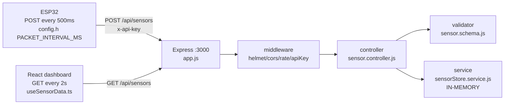

---
tags:
  - backend
  - MOC
aliases:
  - Backend Mastery Index
---

# 00 — Map of Content: Backend Development Mastery

> [!goal] Goal
> Take you from "little backend knowledge" to being able to **design, build, deploy and explain** servers like `nexora2/server` — **without AI** — by understanding every layer yourself. Every note uses *your own code* as the example.

## Interactive legend (these callouts appear in every note)

| Callout | Meaning |
|---------|---------|
| `> [!question] Predict` | Stop and predict **before** running. Then open the collapsed answer. |
| `> [!success]- Reveal` | Collapsed answer — click to expand in Obsidian |
| `> [!example] Try it now` | Exact commands; do them immediately |
| `> [!bug] Debug challenge` | Broken code — find and fix it yourself |
| `> [!important]` | The one idea to remember |
| `> [!warning]` | Common trap / security issue |

> [!tip] The rule that makes all of this work
> **Never read passively.** For every code snippet: cover it, predict, then reveal. This note set is designed to be *done*, not skimmed.

## How to use this vault

1. Study **01 → 12** in order. Each assumes the previous.
2. Keep your real files open beside the notes — every note cites `file:line`.
3. Do the **Try it now** and **Debug challenge** boxes. Typing beats reading.
4. Watch the spine resource alongside: **[Backend from first principles (YouTube playlist)](https://youtube.com/playlist?list=PLui3EUkuMTPgZcV0QhQrOcwMPcBCcd_Q1)** — same first-principles approach.

## Learning path

### Phase 1 — Foundations
| # | Note | You will learn |
|---|------|----------------|
| 01 | [[01 - Backend The Big Picture]] | The 5 parts of every backend; where "API" sits |
| 02 | [[02 - What Is an API]] | API = contract. REST/GraphQL/RPC/WebSocket/webhooks |
| 03 | [[03 - HTTP Fundamentals]] | Request/response, headers, status codes, body |
| 04 | [[04 - HTTP Methods Deep Dive]] | Every method + idempotency, with curl labs |
| 05 | [[05 - REST API Principles]] | REST constraints, resources, status discipline |

### Phase 2 — Understand YOUR project
| # | Note | You will learn |
|---|------|----------------|
| 06 | [[06 - Your Codebase Line by Line]] | **Every server file dissected**, plus frontend + ESP32 flow. Start here if impatient, return often. |

### Phase 3 — Build it by hand
| # | Note | You will learn |
|---|------|----------------|
| 07 | [[07 - Build Your First Server Without AI]] | Raw `node:http` → routing → Express → your architecture |
| 08 | [[08 - Routing Middleware and Project Structure]] | Middleware pipeline, route→controller→service split |
| 09 | [[09 - Validation Auth and Security]] | AJV schema, API keys, CORS, rate limits, helmet |

### Phase 4 — Real-time & alternative APIs
| # | Note | You will learn |
|---|------|----------------|
| 10 | [[10 - WebSockets for Real-Time Data]] | Kill the 2s polling latency; WS handshake + live code |
| 11 | [[11 - GraphQL API]] | Schemas, queries, mutations, subscriptions vs REST |

### Phase 5 — Professional
| # | Note | You will learn |
|---|------|----------------|
| 12 | [[12 - Testing Logging and Production]] | Jest/Supertest, logging, shutdown, deploy |
| 13 | [[13 - Backend Developer Roadmap]] | Beginner → pro: DBs, auth, caching, Docker, design |
| 14 | [[14 - Reliable Resources]] | Official/authoritative resources only |

## The system you're learning (one picture)

## Progress tracker
- [ ] Phase 1 — Foundations
- [ ] Phase 2 — Codebase walkthrough (note 06)
- [ ] Phase 3 — Build it by hand
- [ ] Phase 4 — WebSockets + GraphQL
- [ ] Phase 5 — Production + roadmap
