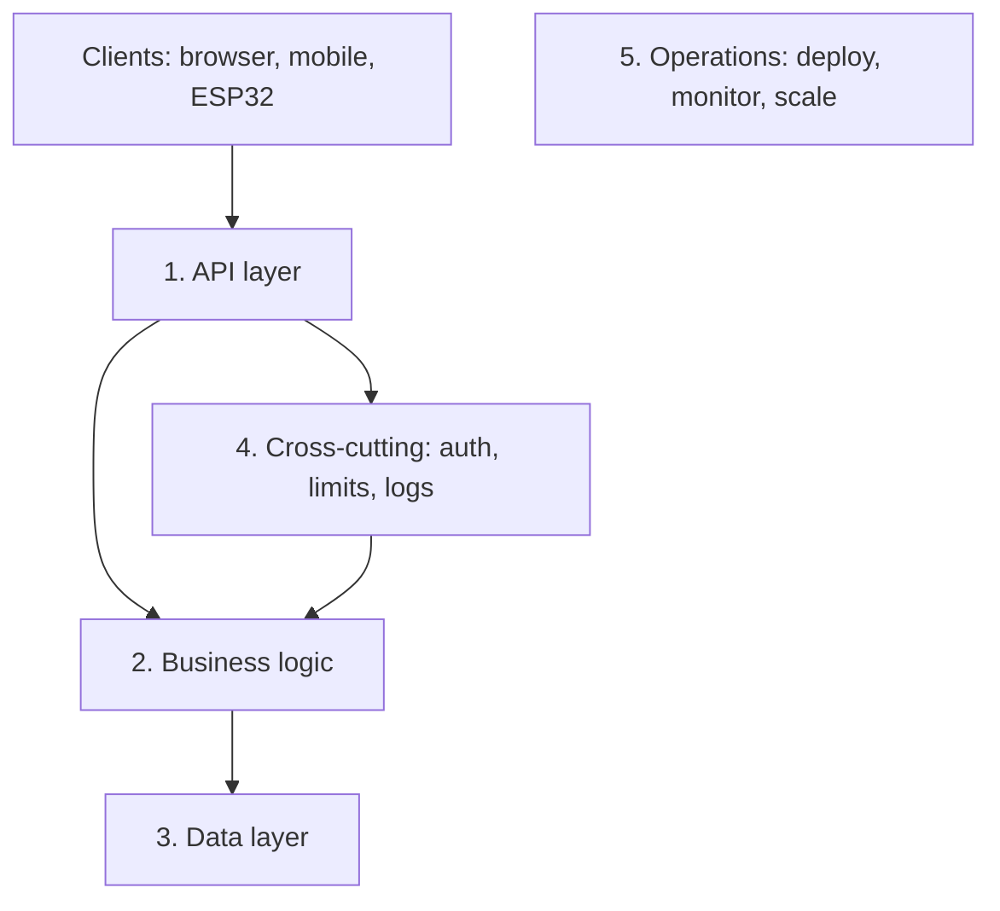
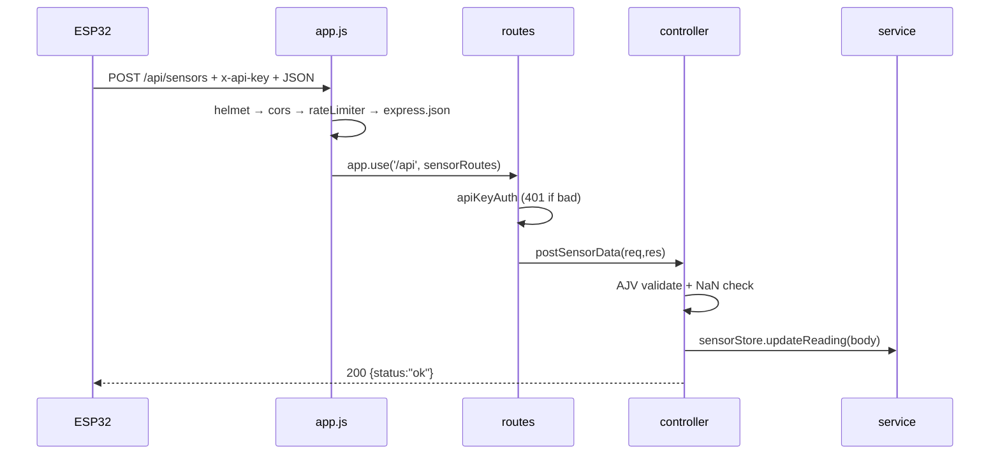

---
tags:
  - backend
  - fundamentals
---

# 01 — Backend: The Big Picture

> [!info] Prerequisite
> None. Next: [[02 - What Is an API]]. Keep `server/src/` open — you'll reference it constantly.

## What "backend" actually means

**Frontend** = code in the browser/device that *renders*. **Backend** = code on a server that *decides*: holds data, enforces rules, answers questions.

> [!important] The trust rule
> The browser can never be trusted — anyone can open DevTools and modify it. The ESP32's firmware can be extracted. So **everything important lives on the backend.** This single rule is why auth, validation, and limits are server-side (note 09).

## The 5 parts of every backend system

| Part | Job | In your project |
|------|-----|-----------------|
| 1. **API layer** | Define what clients can ask | `server/src/routes/sensor.routes.js` |
| 2. **Business logic** | Validate, decide | `server/src/controllers/sensor.controller.js` |
| 3. **Data layer** | Store/retrieve state | `server/src/services/sensorStore.service.js` |
| 4. **Cross-cutting** | Protect & observe | `server/src/middleware/*` |
| 5. **Operations** | Keep it running | `server/src/server.js`, `utils/logger.js` |

> [!important] API = the door
> Everything behind it (logic, data, security) is invisible to clients. REST/GraphQL/WebSocket are *styles of door*. See [[02 - What Is an API]].

## A request's full journey (follow along in the code)

> [!example] Trace it with your own eyes
> 1. `cd server && npm start`
> 2. Add `console.log('HIT /api/sensors', req.method)` as the first line of `postSensorData` in `sensor.controller.js`.
> 3. POST a valid reading (README §8 curl). See the log.
> 4. Now remove the `x-api-key` header and POST again. **The controller log does NOT appear** — `apiKeyAuth` short-circuited it. You just watched the "door" work.

## Key properties you must internalize

1. **HTTP is stateless** — the server forgets between requests. Your server only "remembers" because `sensorStore` holds variables (`sensorStore.service.js:5-9`). That's *your* design choice, not HTTP's.
2. **Node is event-driven, single-threaded** — one thread reacts to events. Blocking CPU work stops *everything*. This is why network I/O is non-blocking and handlers are `async`.
3. **Everything is messages** — status codes, headers, JSON are agreed formats. Learn the format ([[03 - HTTP Fundamentals]]) and you learn the medium.

> [!question] Predict
> Restart the server, then immediately `curl http://localhost:3000/api/sensors`. What is `status` and `source`, and *why*, in terms of the 5 parts above?
>
> > [!success]- Answer
> > `status:"fallback"`, `source:"fallback"` — because the **data layer is in-memory** (`sensorStore.service.js` `lastValidReading=null` at boot). Part 3 died with the process; no persistence exists yet. The permanent fix is a database (note 13).

> [!bug] Debug challenge
> A junior says "the backend remembers the ESP32 from before." Based on `sensorStore.service.js:5-9`, explain in 2 sentences why that's false and what *actually* holds the data.

## Build it yourself (no AI)
- [ ] Draw your own 5-part diagram for this project from memory.
- [ ] Run the "trace it" lab above; write down the middleware order you observed.
- [ ] Answer in 3 lines: backend = ___ ; its API = ___ ; this project's data layer = ___.

## Resources
- Playlist: [Backend from first principles](https://youtube.com/playlist?list=PLui3EUkuMTPgZcV0QhQrOcwMPcBCcd_Q1)
- [MDN: Server-side introduction](https://developer.mozilla.org/en-US/docs/Learn/Server-side/First_steps/Introduction)

Next: [[02 - What Is an API]]
