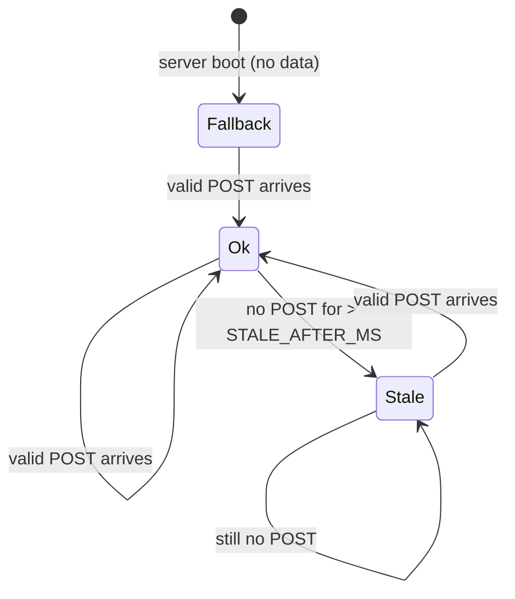

---
tags:
  - codebase
  - walkthrough
  - centerpiece
---

# 06 — Your Codebase, Line by Line

> [!info] Prerequisites
> [[03 - HTTP Fundamentals]] and [[05 - REST API Principles]]. This is the note you'll keep coming back to.
>
> [!tip] How to read this note
> Keep the real files open next to it (`server/src/...`, `frontend/src/...`). For every snippet below, cover the explanation with your hand and **predict what it does** before reading. That single habit is worth more than re-reading.

## 0. The 60-second map

Your project has three programs that talk to each other:

```
ESP32 (C++ firmware)          Node.js server              React app (browser)
POST /api/sensors   ───────►  Express, port 3000  ◄─────  GET /api/sensors every 2s
every 500ms                   stores latest reading       renders dashboard
config.h PACKET_INTERVAL_MS   in a JS variable            useSensorData.ts
```

- The **server** is the only piece that matters for backend learning: `server/src/`.
- The **ESP32** is just a client that happens to be a microcontroller.
- The **React app** is another client that reads data.

Everything below shows *exactly which line* does what, in plain English.

---

## 1. Entry point: `server/src/server.js` (40 lines)

This is the file Node runs (`"start": "node src/server.js"` in `package.json`). Its **only job** is to start and stop the app. It contains no routes and no business logic.

### Lines 1–4 — imports

```js
require('dotenv').config();
const app = require('./app');
const logger = require('./utils/logger');
const config = require('./config');
```

| Line | What it does | Why it matters |
|------|--------------|----------------|
| `dotenv().config()` | Reads the `.env` file into `process.env` | Lets `config/index.js` see `PORT`, `API_KEY`, ... . **Must run before `config` is required.** |
| `require('./app')` | Loads your Express app (all routes/middleware) but **does not start listening** | This separation is what makes tests possible (note 12) |
| `logger` / `config` | The two shared modules used below | |

> [!question] Predict
> What breaks if you move `require('dotenv').config()` **below** `require('./config')`?
>
> > [!success]- Answer
> > `config/index.js` reads `process.env.API_KEY` at require-time. If dotenv hasn't populated `process.env` yet, `config.apiKey` becomes `undefined` → every POST returns 401 forever. Classic order-of-execution bug.

### Lines 8–20 — starting the listener

```js
const startServer = () => {
  server = app.listen(config.port, () => {
    logger.info(`Server started on port ${config.port}`, { env: config.env, port: config.port });
  });

  server.on('error', (err) => {
    logger.error('Server error', { error: err.message });
    process.exit(1);
  });
};
```

- `app.listen(port, callback)` is the line that actually **opens the TCP port** and starts accepting connections. Everything before this was just setup.
- The callback fires **once**, when the OS confirms the port is bound — this is the "server is alive" moment.
- `server.on('error', ...)` handles **fatal infrastructure errors** (most commonly `EADDRINUSE`, port already taken). `process.exit(1)` = exit with failure code so supervisors (pm2/docker) know to care.

> [!question] Predict
> Start the server, then start it a second time in another terminal. What exact error do you see, and from which line?
>
> > [!success]- Answer
> > `Error: listen EADDRINUSE: address already in use :::3000`, caught by the `server.on('error')` handler at `server.js:16`, which logs it and exits. Try it now — this is a top-5 real-world error.

### Lines 22–38 — graceful shutdown + signals

```js
const gracefulShutdown = (signal) => {
  logger.info(`${signal} received, shutting down gracefully`);
  if (server) {
    server.close(() => { logger.info('Server closed'); process.exit(0); });
  } else { process.exit(0); }
};

process.on('SIGTERM', () => gracefulShutdown('SIGTERM'));
process.on('SIGINT',  () => gracefulShutdown('SIGINT'));

startServer();
```

- **Signals** are how the operating system says "please stop". `SIGINT` = you pressed Ctrl+C. `SIGTERM` = `docker stop`, pm2, most orchestrators.
- `server.close(cb)` = **stop accepting new connections, finish the in-flight ones, then call cb**. Without this, Ctrl+C drops active requests mid-flight.
- `process.exit(0)` = orange "success" exit code (0 = clean).

> [!important] The structural lesson
> `server.js` = **process concerns** (start, stop, signals). `app.js` = **HTTP concerns** (routes, middleware). Keeping them apart is a professional habit you'll see in every serious Node codebase.

> [!example] Try it now
> 1. `cd server && npm start`
> 2. Open a second terminal and `curl http://localhost:3000/api/health`
> 3. Go back to the server terminal, press **Ctrl+C**, read the log lines. You just exercised `SIGINT` → `gracefulShutdown`.

---

## 2. The app: `server/src/app.js` (69 lines)

This file is the **middleware + routes assembly line**. Requests travel top-to-bottom. Read it as a checklist.

### Lines 1–9 — imports

```js
const express = require('express');
const cors = require('cors');
const helmet = require('helmet');
const path = require('path');
const sensorRoutes = require('./routes/sensor.routes');
const notFound = require('./middleware/notFound');
const errorHandler = require('./middleware/errorHandler');
const rateLimiter = require('./middleware/rateLimiter');
```

Each import is a **middleware or router** you'll meet one-by-one. Notice they're all small single-purpose files — that's the pattern.

### Line 11 — creating the app

```js
const app = express();
```

One line, large meaning: this object collects every route and middleware you attach to it. It becomes the "request pipeline".

### Lines 14–24 — helmet (security headers)

```js
app.use(helmet({
  contentSecurityPolicy: {
    directives: {
      defaultSrc: ["'self'"],
      scriptSrc: ["'self'", "'unsafe-inline'"],
      styleSrc: ["'self'", "'unsafe-inline'"],
      imgSrc: ["'self'", 'data:', 'https:'],
      connectSrc: ["'self'", 'https://taskcanvas.me'],
    },
  },
}));
```

- `app.use(x)` = "run `x` for **every** request". Order here = execution order (note 08).
- `helmet()` sets security-related **response headers**. The object you pass **customizes the Content-Security-Policy** — the browser rule that says which scripts/styles/connections a page may use.
- `connectSrc: ["'self'", 'https://taskcanvas.me']` = the backend may only be contacted by your own page and your domain. If a malicious script got injected into the dashboard, the browser would **block it from phoning home**. This is a real, concrete defense.

> [!question] Quiz
> A developer removes the whole `helmet(...)` block. Does the API still work? Yes or no, and what *class* of problem returns?
>
> > [!success]- Answer
> > Yes, it still works — helmet changes no API behavior. What returns is a class of **browser-side security risks** (XSS helpers, clickjacking, MIME sniffing). Security headers are "free insurance", never a feature.

### Lines 27–44 — CORS (the cross-origin gate)

```js
const allowedOrigins = [
  'https://nfrontend.taskcanvas.me',
  'https://taskcanvas.me',
  'http://localhost:5173',
  'http://localhost:3000',
];

app.use(cors({
  origin: (origin, callback) => {
    if (!origin) return callback(null, true);
    if (allowedOrigins.includes(origin)) return callback(null, true);
    return callback(new Error('Not allowed by CORS'));
  },
  credentials: true,
  methods: ['GET', 'POST', 'OPTIONS'],
  allowedHeaders: ['Content-Type', 'x-api-key'],
}));
```

Read it in three parts:

1. **The whitelist** — exactly which websites may call this API from a browser. `localhost:5173` is your Vite dev server; the others are production.
2. **The `origin` function** — `!origin` (no Origin header) means a **non-browser** client: curl, Postman, or your ESP32. CORS is a *browser* mechanism, so non-browsers are allowed. A browser sends `Origin`, and it must be in the list.
3. **`methods` + `allowedHeaders`** — the contract of what's permitted. `x-api-key` is listed because your browser clients might send it. GET/POST/OPTIONS only — **PUT/PATCH/DELETE would fail here** if you ever add them (note 04 says you will).

> [!warning] The bug-in-waiting
> If you add `DELETE /api/sensors/:id` (note 04 exercise) and forget to add `'DELETE'` to `methods`, the browser blocks it with a CORS error even though curl works fine. This is the #1 confusing CORS bug. Remember: **curl bypasses CORS; only browsers enforce it.**

### Line 47 — rate limiting

```js
app.use(rateLimiter);
```

One line mounts "max N requests per minute per IP" (defined in `middleware/rateLimiter.js`, note 09). Placed **before** the routes so it guards everything.

### Lines 50–51 — body parsing

```js
app.use(express.json({ limit: '10kb' }));
app.use(express.urlencoded({ extended: true, limit: '10kb' }));
```

- `express.json()` reads the raw request body **stream** and parses JSON into `req.body`. Before this middleware runs, `req.body` is `undefined`. (Note 07 shows the hand-rolled 25-line version of exactly this.)
- `limit: '10kb'` caps body size → protects memory. Bigger payloads get a `413` (handled in `errorHandler.js`).
- `urlencoded` parses classic HTML form bodies (`a=1&b=2`).

### Line 54 — mounting routes

```js
app.use('/api', sensorRoutes);
```

Everything in `sensor.routes.js` is prefixed with `/api`. So `router.post('/sensors', ...)` becomes `POST /api/sensors`. **This is the joining line between `app.js` and `sensor.routes.js`** — follow it.

### Lines 57–61 — health shortcut

```js
app.get('/api/health', (req, res) => {
  const sensorStore = require('./services/sensorStore.service');
  const health = sensorStore.getHealthStatus();
  res.json(health);
});
```

A second `/api/health` route (there's also one in the router!). It requires the service *inline* — slightly unusual (usually you'd import at the top), but functionally fine. `res.json(obj)` = auto-sets `Content-Type: application/json` and sends.

> [!question] Predict
> `app.js:57` defines `GET /api/health` **and** `sensor.routes.js:13` defines `GET /health` (which becomes `/api/health`). Which one wins when you call `/api/health`?
>
> > [!success]- Answer
> > The one registered **first**. `/api/health` (line 57) is mounted before `app.use('/api', sensorRoutes)` is reached? No — line 54 (routes) comes *before* line 57. So **`sensor.routes.js` wins** and line 57's handler never runs. Duplicate routes = confusing; deleting one is a good first cleanup. (Verify by adding a log line to each and calling it.)

### Lines 64–67 — the final two middleware

```js
app.use(notFound);
app.use(errorHandler);
```

- `notFound` runs only if **nothing above matched** → clean `404`.
- `errorHandler` has 4 arguments `(err, req, res, next)` → Express identifies it as an **error handler** and routes all errors (thrown or `next(err)`) here.
- **These must be last.** Move them up and they'd swallow requests meant for real routes.

---

## 3. Routes: `server/src/routes/sensor.routes.js` (15 lines)

The whole file, explained:

```js
const sensorController = require('../controllers/sensor.controller');
const apiKeyAuth = require('../middleware/apiKeyAuth');
const router = require('express').Router();

router.post('/sensors', apiKeyAuth, sensorController.postSensorData);
router.get('/sensors', sensorController.getLatestSensorData);
router.get('/health', sensorController.getHealthStatus);

module.exports = router;
```

| Piece | Meaning |
|-------|---------|
| `express.Router()` | A mini-app: same `.get/.post` API, mounted anywhere |
| `router.post('/sensors', apiKeyAuth, handler)` | **Two** functions for one route: run `apiKeyAuth` first, then the handler **only if it called `next()`** |
| `module.exports = router` | Handed to `app.use('/api', ...)` — together they form `/api/sensors` |

> [!important] The single most useful line-reading skill in Express
> `router.post('/sensors', A, B, C)` means: match `POST /sensors` → run `A`, then `B`, then `C`, each via `next()`. **Reading the route list tells you the entire request flow for that endpoint.** GET `/sensors` has no `apiKeyAuth` → it's public. POST has it → protected.

> [!example] Try it now — watch the chain
> Temporarily add `console.log('AUTH')` to `apiKeyAuth.js` and `console.log('CONTROLLER')` to `postSensorData`. Call POST without a key: you'll see `AUTH` only. Call with the right key: you'll see both. **Feel** middleware short-circuiting.

---

## 4. Controller: `server/src/controllers/sensor.controller.js` (84 lines)

A controller = **the translator between HTTP and your logic**. It only knows `req`/`res` + calling a service.

### Lines 8–21 — validate first

```js
const postSensorData = (req, res, next) => {
  try {
    const isValid = validateSensorData(req.body);
    if (!isValid) {
      const errors = validateSensorData.errors;
      logger.warn('Invalid sensor data received', { errors });
      return res.status(400).json({
        error: 'Invalid payload',
        message: 'Sensor data does not match required schema',
        details: errors
      });
    }
    ...
```

- `req.body` was filled by `express.json()` (→ the data the ESP32 sent).
- `validateSensorData` is AJV-compiled (from `validators/sensor.schema.js`) — returns `true/false`, and stashes all failure reasons on `.errors` (note 09 dissects the schema).
- On failure: **`400`** + a structured error. Note the `logger.warn` — invalid input is a fact worth recording, not a crash.
- `return` prevents falling through to the storage step. Forgetting `return` here would store invalid data — a real bug class.

### Lines 24–45 — the NaN guard

```js
const checkForNaN = (obj) => {
  for (const key in obj) {
    if (typeof obj[key] === 'object' && obj[key] !== null) {
      if (checkForNaN(obj[key])) return true;
    } else if (typeof obj[key] === 'number') {
      if (isNaN(obj[key]) || !isFinite(obj[key])) return true;
    }
  }
  return false;
};
```

A **recursive** function (it calls itself) that walks every nested field and rejects `NaN` / `Infinity`. Why bother if AJV already ran? Because JSON Schema's `number` type technically permits `NaN`/`Infinity` in some interpretations — an exact, hard-won domain check. This is the kind of "second line of defense" pros add for values that corrupt math downstream.

> [!example] Predict before running
> Send `{"uptime_ms": 1e999, ...}` (JSON parses `1e999` as `Infinity`). Which check catches it — AJV or `checkForNaN`? Try with a valid-key curl. Answer: the schema passes, **`checkForNaN`** catches it → `400`.

### Lines 47–58 — store + respond

```js
    sensorStore.updateReading(req.body);

    logger.info('Sensor data received successfully', {
      deviceId: req.body.deviceId,
      deviceTimestamp: req.body.deviceTimestamp
    });

    res.status(200).json({ message: 'Data received successfully', status: 'ok' });
  } catch (err) {
    next(err);
  }
};
```

- `sensorStore.updateReading(...)` — **the entire "database"**. One function call. The controller doesn't know *how* it's stored (memory today, Postgres tomorrow — note 13).
- `res.status(200).json(...)` — sets status + sends JSON. This is the ESP32's success signal.
- `catch (err) { next(err) }` — any unexpected throw is forwarded to `errorHandler`. **`next(err)` is how you hand a problem up the chain** instead of crashing.

> [!question] Quiz
> Notice `logger.info` uses `req.body.deviceId`, but the schema (and the frontend types) use `device_id` with an **underscore**. What will the log show?
>
> > [!success]- Answer
> > `undefined`. `deviceId` isn't a field in the payload — the ESP32 sends `device_id`. So your "successfully received" log line prints `deviceId: undefined`, hiding the real device id. **A genuine bug in the code you can fix**: change it to `req.body.device_id`. Bugs like this are found by *reading logs and code together* — the exact skill this note trains.

### Lines 67–78 — the read + health handlers

```js
const getLatestSensorData = (req, res) => {
  const data = sensorStore.getLatestReading();
  res.status(200).json(data);
};

const getHealthStatus = (req, res) => {
  const health = sensorStore.getHealthStatus();
  res.status(200).json(health);
};
```

Thin pass-throughs: call one service method, return its result. No `try/next` because these can't realistically throw (pure in-memory reads). The controller stays dumb on purpose — all decisions live in the service.

---

## 5. Service: `server/src/services/sensorStore.service.js` (141 lines)

**This is the brain of the backend.** No `req`, no `res`, no Express — just state + rules. Because of that, it's testable (note 12) and reusable by a future WebSocket handler (note 10).

### Lines 4–10 — the state

```js
class SensorStoreService {
  constructor() {
    this.lastValidReading = null;
    this.lastContactTime = null;
    this.lastDeviceTimestamp = null;
    this.deviceRebootedAt = null;
  }
```

Four variables = the **entire memory** of the system. `null` at boot is why, after a restart, `GET /api/sensors` returns `fallback` (note 01 exercise). A class instance created once and exported (line 140) = a **singleton** — everyone shares this one object.

> [!warning] Why this design blocks scaling
> Because state lives *in this process's RAM*, running two server instances means **two different truths** (instance A has the latest reading; B doesn't). The fix is a shared database/cache (note 13). Recognize the smell: "in-memory state" = "single-instance only".

### Lines 12–50 — `getFallbackReading()`

```js
getFallbackReading() {
  const now = new Date().toISOString();
  return {
    status: 'fallback', source: 'fallback', deviceId: 'esp32-01',
    timestamp: now, deviceTimestamp: 0, ageMs: 0,
    device_id: 'esp32-01', uptime_ms: 0,
    mpu6050: { ok: false, accel_x: null, ... },
    ultrasonic: { distance_cm: null, obstacle_detected: false },
    sharp_ir: { voltage: null, distance_cm: null },
    gps_valid: false, gps_fallback: true,
    latitude: 28.7975, longitude: 77.5389, gps_speed_kmph: 0,
    emergency_button: false, crash_detected: false, wifi_rssi_dbm: 0
  };
}
```

Returns a **complete object with the same shape** as a real reading, but `null`s + `valid:false` flags. The design goal: **a client should never crash because data is missing** — it always gets the expected fields. This "always return a consistent shape" principle is why the frontend can do `sensorData.mpu6050.accel_x` without guards.

> [!question] Predict
> Why does the fallback return `latitude: 28.7975` (a real-looking value) rather than `null`?
>
> > [!success]- Answer
> > Deliberate UX choice: the dashboard map/coordinates shouldn't break or point at `(0,0)` (which is in the ocean). It's paired with `gps_valid:false, gps_fallback:true` so any honest consumer can *tell* it's not a real fix. "Same shape, honest flags" — remember this pattern.

### Lines 52–74 — `updateReading(data)` (the write path)

```js
updateReading(data) {
  const now = Date.now();
  const serverTime = new Date(now).toISOString();

  if (this.lastDeviceTimestamp !== null && data.uptime_ms < this.lastDeviceTimestamp) {
    logger.info('Device reboot detected', {
      previous: this.lastDeviceTimestamp, current: data.uptime_ms
    });
    this.deviceRebootedAt = now;
  }

  this.lastDeviceTimestamp = data.uptime_ms;
  this.lastValidReading = { ...data, serverTimestamp: now, serverTimeIso: serverTime };
  this.lastContactTime = now;
}
```

Three ideas in 20 lines:

1. **`Date.now()` vs `new Date(...).toISOString()`** — two time formats: epoch ms (a number, easy to subtract) and ISO string (human/JSON friendly). You'll use both forever.
2. **Reboot detection** — `uptime_ms` is the device's "how long since boot". If the new value is *smaller* than the last one, the device must have rebooted (counter reset). Why do we care? Because trusting a rebooted device's clock would corrupt age calculations.
3. **The spread `{ ...data, serverTimestamp, serverTimeIso }`** — copies every field from the device, then adds server-side fields. This is why responses contain **both** `uptime_ms` (from device) *and* `serverTimestamp` (added by server) — a deliberate trust model: keep device data, annotate with server truth.

> [!important] Server time vs device time
> `lastContactTime` is **server** time. All staleness math uses it. If it used device time, a device with a wrong clock could fake freshness. **Never let an untrusted client drive your security/liveness logic.** This is a reusable security principle.

### Lines 76–111 — `getLatestReading()` (the read path + state machine)

```js
getLatestReading() {
  const now = Date.now();

  if (this.lastValidReading === null || this.lastContactTime === null) {
    return this.getFallbackReading();            // STATE 1: fallback
  }

  const ageMs = now - this.lastContactTime;

  if (ageMs > config.staleAfterMs) {             // STATE 2: stale
    return { status: 'stale', source: 'cache', ageMs, ...this.lastValidReading };
  }

  return { status: 'ok', source: 'esp32', ageMs, ...this.lastValidReading }; // STATE 3: ok
}
```

This is a **3-state machine** — the heart of the project's reliability design:



- `ageMs = now - lastContactTime` = "how old is the data?" — the most useful derived number in the whole API.
- `config.staleAfterMs` (default 5000) is the threshold. **Compare against server time only.**
- The `status`/`source` pair tells the client *why* it's seeing what it's seeing:
  - `ok`/`esp32` → live
  - `stale`/`cache` → old but was real
  - `fallback`/`fallback` → never had real data

> [!success] Interactive: trace it yourself
> With the server running, run this exact sequence and record the `status` after each step:
> 1. `curl localhost:3000/api/sensors` → status = ?
> 2. POST a valid reading (use README §8 curl) → 
> 3. `curl localhost:3000/api/sensors` immediately → status = ?
> 4. Wait 6 seconds → `curl` again → status = ?
> 5. POST again → `curl` → status = ?
> Write your 5 answers before checking. If step 4 didn't say `stale`, look at your `STALE_AFTER_MS` in `.env`.

### Lines 113–137 — `getHealthStatus()`

```js
getHealthStatus() {
  const now = Date.now();
  const uptime = process.uptime();
  if (this.lastContactTime === null) {
    return { status: 'unhealthy', uptime, lastEsp32Contact: null, connected: false, ageMs: null };
  }
  const ageMs = now - this.lastContactTime;
  const connected = ageMs <= config.staleAfterMs;
  return { status: connected ? 'healthy' : 'degraded', uptime,
           lastEsp32Contact: new Date(this.lastContactTime).toISOString(), connected, ageMs };
}
```

Same data as `getLatestReading`, different question: *"Is the device reachable?"* → `healthy / degraded / unhealthy`. `process.uptime()` is the Node process's own age in seconds. **Separate your "device health" from your "data freshness"** — they overlap but answer different questions, and monitoring tools poll health separately.

> [!note] Naming detail worth noticing
> The class has `getLatestReading` and `getHealthStatus`, but also there's an **inconsistency**: `generate`/`update` prefix styles. Pros unify verbs (`getX` vs `updateX`). Small thing, but "consistent naming" is a signal of a mature codebase. Rename candidates: `getFallbackReading` is fine; the mix is okay — just be consistent going forward.

---

## 6. Validators: `server/src/validators/sensor.schema.js` (60 lines)

```js
const Ajv = require('ajv');
const ajv = new Ajv({ allErrors: true, strict: false });

const sensorSchema = {
  type: 'object',
  properties: {
    device_id: { type: 'string', minLength: 1 },
    uptime_ms: { type: 'number', minimum: 0 },
    mpu6050: {
      type: 'object',
      properties: {
        accel_x: { type: 'number', minimum: -160, maximum: 160 },
        ...
      },
      required: ['ok', 'accel_x', ...],
      additionalProperties: false
    },
    ...
  },
  required: ['device_id', 'uptime_ms', 'mpu6050', ...],
  additionalProperties: false
};

const validateSensorData = ajv.compile(sensorSchema);
module.exports = { validateSensorData, sensorSchema };
```

- This is a **JSON Schema** — a data-file description of what a valid payload looks like.
- `ajv.compile(schema)` turns it into a fast validating **function** you call as `validateSensorData(req.body)`.
- `minimum/maximum` = the sensor's **physical plausibility ranges** (accel ±160 m/s² etc.) — your datasheet encoded as code. Note 09 digs into every field.

> [!example] Break it deliberately
> POST with these bodies (valid key) and observe `400` + `details` each time:
> - `{"device_id": ""}` → fails `minLength`
> - `{"device_id": "x", "uptime_ms": -5}` → fails `minimum: 0`
> - `{"device_id": "x", "uptime_ms": 1, "mpu6050": {"accel_x": 999}}` → fails `maximum`
> - a body with an **extra** field → fails `additionalProperties: false`
> Read the `details` array each time. You're reading AJV's error reports — a daily skill.

---

## 7. Middleware: `server/src/middleware/apiKeyAuth.js` (23 lines)

```js
const apiKeyAuth = (req, res, next) => {
  const apiKey = req.headers['x-api-key'];
  if (!apiKey) {
    return res.status(401).json({ error: 'API key is required', message: 'Missing x-api-key header' });
  }
  if (apiKey !== config.apiKey) {
    return res.status(401).json({ error: 'Unauthorized', message: 'Invalid API key' });
  }
  next();
};
```

Line-by-line:
- `req.headers['x-api-key']` — HTTP headers are lowercased by Node; the client sent `x-api-key` (or `X-API-Key` — same thing).
- Missing key → `401` + **`return`** (returning stops the function; without it we'd fall through and maybe call `next()` — a security hole).
- Wrong key → `401`. `config.apiKey` comes from `.env` (via `config/index.js`).
- Correct → `next()` → the controller finally runs.

> [!warning] Security notes about this exact code
> 1. `===` is a **fast, timing-leaky** comparison. A determined attacker can in theory infer the key byte-by-byte from response-time differences. Real systems use `crypto.timingSafeEqual`. Knowing this exists = senior signal.
> 2. One shared key for all devices has no revocation. Note 09 covers per-device keys.
> 3. Your ESP32's key is currently hard-coded in `esp32/esp32_sensor_node/config.h`. Firmware on a device can be read/extracted — so treat that key as **semi-public** and rotate it. (This is why serious IoT uses per-device keys + mutual TLS.)

---

## 8. Middleware: `rateLimiter.js`, `notFound.js`, `errorHandler.js`

### `rateLimiter.js` (15 lines)
```js
const rateLimiter = rateLimit({
  windowMs: 60 * 1000,
  max: config.rateLimit,        // 100/min from .env
  message: { error: 'Too many requests, please try again later.', status: 429 },
  standardHeaders: true,
  legacyHeaders: false
});
```
`express-rate-limit` counts requests per IP in a 60s window; over `max` → `429`. `standardHeaders: true` adds `RateLimit-*` response headers so clients can back off politely.

> [!question] Predict
> Your ESP32 POSTs every 500ms = 120 requests/min. Your limit is 100/min. What happens, and when?
>
> > [!success]- Answer
> > After ~100 requests in a minute, every further POST gets **429** until the window rolls over. In `config.h` the send interval is `PACKET_INTERVAL_MS = 500` → exactly this risk. Real symptom: dashboard freezes → goes `stale`/`degraded`. The fix is a product decision: raise `RATE_LIMIT`, lengthen the interval, or exempt device keys. **Follow the numbers from config → behavior → user-visible effect.** This is backend thinking.

### `notFound.js` (8 lines)
```js
const notFound = (req, res, _next) => {
  res.status(404).json({ error: 'Not Found', message: 'Route ' + req.originalUrl + ' not found' });
};
```
Only runs if no route matched. `req.originalUrl` echoes the bad path in the message — great for debugging ("I typo'd the URL"). The `_next` underscore-prefix convention = "I must accept this arg (Express), but I don't use it".

### `errorHandler.js` (33 lines)
```js
const errorHandler = (err, req, res, _next) => {
  logger.error('Error occurred', { error: err.message, stack: err.stack, path: req.path, method: req.method });

  if (err instanceof SyntaxError && err.status === 400 && 'body' in err) {
    return res.status(400).json({ error: 'Invalid JSON', message: 'Request body contains malformed JSON' });
  }
  if (err.type === 'entity.too.large') {
    return res.status(413).json({ error: 'Payload too large', message: 'Request body exceeds size limit' });
  }
  res.status(err.status || 500).json({
    error: err.message || 'Internal Server Error',
    ...(process.env.NODE_ENV === 'development' && { stack: err.stack })
  });
};
```
- **4 args = Express error-handler signature.** Any `next(err)` or thrown error lands here; this is the *single place* errors become JSON.
- It recognizes **two framework-specific errors**: malformed JSON (Express throws `SyntaxError` with `.status 400`) → custom `400`; oversized body (`entity.too.large`) → custom `413`.
- Everything else → `err.status || 500`. And it only includes `stack` when `NODE_ENV === 'development'` — **never leak traces in production**. This one line is a security best practice.

> [!example] Cause all three errors on purpose
> ```
> curl -X POST localhost:3000/api/sensors -H "x-api-key: WRONG" -d "{bad json"
> curl -X POST localhost:3000/api/sensors -H "x-api-key: RIGHT" -H "Content-Type: application/json" --data-binary "@bigfile"
> curl localhost:3000/does-not-exist
> ```
> Read each response + the server log. You now understand your own error pipeline end to end.

---

## 9. Utils: `server/src/utils/logger.js` (14 lines) — and a dependency trap

```js
module.exports = {
  info: (message, meta = {}) => { console.log(`[INFO] ${new Date().toISOString()} ${message}`, meta); },
  error: (message, meta = {}) => { console.error(`[ERROR] ${new Date().toISOString()} ${message}`, meta); },
  warn: (message, meta = {}) => { console.warn(`[WARN] ${new Date().toISOString()} ${message}`, meta); },
  debug: (message, meta = {}) => { console.debug(`[DEBUG] ${new Date().toISOString()} ${message}`, meta); }
};
```

It's a **thin plain-console wrapper**, not a logging library. Each method prefixes a level + ISO timestamp and passes an optional object.

> [!warning] A real codebase lesson
> `package.json` declares **`winston`** as a dependency, but this file uses `console`. So winston is installed but **never imported** — dead weight. Also notice `LOG_LEVEL` from `.env` is read in `config`, but this logger **ignores it** — `debug` always prints. Two genuine issues you can fix as an exercise:
> 1. Either adopt winston properly, or drop the dependency.
> 2. Make `debug` respect `config.logLevel`.
> Learning to spot **declared-but-unused** code is a core code-review skill. (Note 12 covers doing logging "right".)

---

## 10. Config: `server/src/config/index.js` + `.env.example` (8 + 5 lines)

```js
module.exports = {
  env: process.env.NODE_ENV || 'development',
  port: parseInt(process.env.PORT || '3000', 10),
  apiKey: process.env.API_KEY,
  staleAfterMs: parseInt(process.env.STALE_AFTER_MS || '5000', 10),
  rateLimit: parseInt(process.env.RATE_LIMIT || '100', 10),
  logLevel: process.env.LOG_LEVEL || 'info'
};
```

- **One module reads `process.env` for the whole app.** Everything else imports `config`. This is *the* pattern for configurable systems.
- `parseInt(..., 10)` because everything in env is a **string** — `"3000"` must become the number `3000`.
- The `|| 'default'` fallbacks make the app runnable with *no* `.env` (great for local dev), except `apiKey` which has no default — hence a missing key silently becomes `undefined` and all POSTs 401. **A production-grade version should `process.exit(1)` if `apiKey` is missing** (note 12 exercise).
- `.env.example` documents the real variables; `.env` (gitignored) holds secrets. Confirm `.env` is **not** committed — check `git status` / your `.gitignore`.

> [!example] Prove the config flow
> 1. In `.env`, set `STALE_AFTER_MS=1000`, restart, POST once, then `curl` after 2s → now `stale` much faster.
> 2. Set `RATE_LIMIT=5`, restart, run `curl` 6 times quickly → the 6th is `429`.
> You just changed runtime behavior **without touching code**. That's why config exists.

---

## 11. Tests: `server/tests/sensor.test.js` (93 lines)

```js
process.env.API_KEY = 'test-api-key';
process.env.NODE_ENV = 'test';

const request = require('supertest');
const app = require('../src/app');

describe('Sensor API', () => {
  const apiKey = 'test-api-key';

  test('POST /api/sensors without API key should return 401', async () => {
    const res = await request(app).post('/api/sensors').send({ device_id: 'test', uptime_ms: 123 });
    expect(res.statusCode).toBe(401);
  });
  ...
```

- `process.env` is set **before** requiring the app, so `config` picks up the test key. Order matters (same lesson as `dotenv` in `server.js`).
- `request(app)` runs **the real Express app in-process** — no live server needed. Supertest opens a temporary socket, sends a real HTTP request, returns the response.
- Each `test(...)` = Arrange/Act/Assert: build request → `await` → `expect`. Read the 7 tests; together they *are* the API's contract (validation of 401s, 400, fallback, then success).

> [!warning] The test-order dependency hiding here
> The last test ("after valid post should return ok") **depends** on the 6th test having POSTed data first — they share the module-level `sensorStore`. Reordering or running one in isolation breaks it. This is the "shared mutable state between tests" smell from note 12. The professional fix: a `beforeEach` that resets the store.

> [!example] Run the suite and read it
> `cd server && npm test`. Then open the config: `jest.config.js` has `testEnvironment: 'node'` (no fake browser DOM). Watch the tests pass — each green check is one piece of your contract machine-verified.

---

## 12. The frontend flow (why the backend looks the way it does)

You don't need to master React, but you must understand how your server is **consumed**.

### `frontend/src/services/api.ts` — the client contract
```ts
const API_BASE = '/api';
export const api = {
  getSensorData: () => fetchJson<SensorDataResponse>(`${API_BASE}/sensors`),
  getHealth:     () => fetchJson<HealthResponse>(`${API_BASE}/health`),
  postSensorData: (payload, apiKey) => fetchJson(`${API_BASE}/sensors`, {
    method: 'POST', headers: { 'x-api-key': apiKey }, body: JSON.stringify(payload)
  }),
};
```
- `API_BASE = '/api'` (relative!) — the browser calls its **own origin**, and Vite's dev proxy (`vite.config.ts:18-23`) forwards `/api/*` to `http://localhost:3000`. That's why no CORS/port numbers appear here in dev.
- The `postSensorData` function mirrors **exactly** the ESP32's POST: same path, same `x-api-key` header. The frontend even has a manual "post data" test tool using this.

### `frontend/src/hooks/useSensorData.ts` — the polling loop
```ts
export function useSensorData(pollInterval = 2000) {
  return useQuery({
    queryKey: QUERY_KEYS.sensorData,
    queryFn: api.getSensorData,
    refetchInterval: pollInterval,       // Dashboard passes 2000
    refetchIntervalInBackground: true,
  });
}
```
- `refetchInterval: 2000` = **the browser calls `GET /api/sensors` every 2 seconds, forever.** `Dashboard.tsx:25` sets `POLL_INTERVAL = 2000` and passes it in (line 31).
- This is the source of the latency you'll eliminate in [[10 - WebSockets for Real-Time Data]]: data can be up to 2s old, and the server answers even when nothing changed.

### `frontend/src/components/Dashboard.tsx` — how the data is used
- Line 31: `useSensorData(POLL_INTERVAL)` produces `{ data, isLoading, error, refetch }`.
- Lines 34–41: every new reading is **appended to `chartHistory`** and capped at 50 via `next.slice(-CHART_HISTORY_SIZE)` — a tiny client-side ring buffer (compare note 01's "state lives in memory" idea).
- Lines 82–88: it reads `sensorData.status`, `sensorData.source`, `sensorData.ageMs`, `health.connected` — **the exact fields your service computes**. The 3-state machine from §5 drives the whole UI (Status badge, Online/Stale/Offline card, Data Age card).

> [!important] The full feedback loop (memorize this)
> ESP32 POST → `apiKeyAuth` → controller → **AJV validate** → `sensorStore.updateReading` → (2s later) browser GET → `getLatestReading` computes `ok/stale/fallback` → React renders a badge. **Every note in this vault describes one link in this chain.** If you can narrate this sentence, you understand your backend.

---

## 13. The ESP32 side (client #1) — just enough

- `config.h:7` — `SERVER_URL "https://taskcanvas.me/api/sensors"`: the device POSTs to **your production `/api/sensors`**.
- `config.h:8` — `API_KEY`: the `x-api-key` value (keep this secret; don't commit real keys).
- `config.h:29-31` — `SENSOR_INTERVAL_MS 100`, `DASHBOARD_INTERVAL_MS 2000`, `PACKET_INTERVAL_MS 500`: read sensors every 100ms, **POST to the server every 500ms**.
- `esp32_sensor_node.ino` sends JSON with `device_id`, `uptime_ms`, `mpu6050{...}`, `ultrasonic{...}`, `sharp_ir{...}`, GPS, flags — **exactly the fields your AJV schema requires** and the frontend types describe.

> [!question] Connect the dots
> The ESP32 sends every 500ms (120/min) but `RATE_LIMIT=100`. Name the two-player conflict and one fix on each side.
>
> > [!success]- Answer
> > Device sends more often than the server allows. Server-side fix: raise `RATE_LIMIT` or exempt API-key'd device routes. Device-side fix: lengthen `PACKET_INTERVAL_MS` (e.g. 1000ms = 60/min) — or batch multiple readings. The "right" fix depends on how fresh you need the dashboard. **Design is trade-offs, not answers.**

---

## 14. Your turn — three code-reading challenges

> [!example] Challenge 1 — Find the duplicate route
> `GET /api/health` is defined in **two places**. Find both (`app.js` and `sensor.routes.js`), prove which one runs (add a unique log to each), then delete the loser. Write one sentence on why duplicates are dangerous.

> [!example] Challenge 2 — Fix the log bug
> In `sensor.controller.js:52`, `deviceId`/`deviceTimestamp` don't exist (they're `device_id`/`uptime_ms`). Fix the log fields, restart, POST, and confirm the log now shows the real device id. 

> [!example] Challenge 3 — Make the logger obey `LOG_LEVEL`
> `utils/logger.js` ignores `config.logLevel`, so `debug` always prints. Make `debug` print **only** when `LOG_LEVEL=debug`. Test with `LOG_LEVEL=info npm start` (debug lines should vanish) and `LOG_LEVEL=debug npm start`.

> [!example] Challenge 4 — Break and explain
> Comment out `app.use(express.json())` in `app.js`, restart, and POST a body. Read the resulting error. Explain in one line why `req.body` is now `undefined` and why *order* saved you from this in normal runs.

Solutions aren't provided on purpose — the **process** (read → predict → run → observe) is the lesson. If stuck, re-read §4 and §2.

---

## 15. One-page cheat sheet (pin this)

| Question | Answer (in your code) |
|----------|----------------------|
| Where does the process start? | `server/src/server.js:38` → `startServer()` |
| What opens the port? | `app.listen(config.port)` — `server.js:9` |
| Where is the middleware order? | `server/src/app.js:14-67` (top→bottom) |
| Where are endpoints declared? | `server/src/routes/sensor.routes.js:7-13` |
| Where does HTTP meet logic? | `server/src/controllers/sensor.controller.js` |
| Where is the "database"? | `server/src/services/sensorStore.service.js` (in-memory) |
| Where is validation? | `validators/sensor.schema.js` + `checkForNaN` in controller |
| Where is auth? | `middleware/apiKeyAuth.js` |
| Where do errors become JSON? | `middleware/errorHandler.js:3` (4-arg function) |
| Where is config/secrets? | `config/index.js` reading `.env` |
| Where is the client polling? | `frontend/src/hooks/useSensorData.ts:9-19` (`refetchInterval: 2000`) |
| Where does the device POST? | `esp32/.../config.h:7` + `.ino` every 500ms |

## Resources
- Playlist: [Backend from first principles](https://youtube.com/playlist?list=PLui3EUkuMTPgZcV0QhQrOcwMPcBCcd_Q1)
- Next: [[07 - Build Your First Server Without AI]] — rebuild every file above from scratch, by hand.
