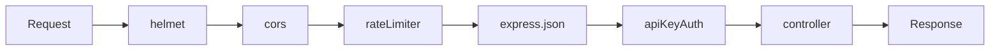
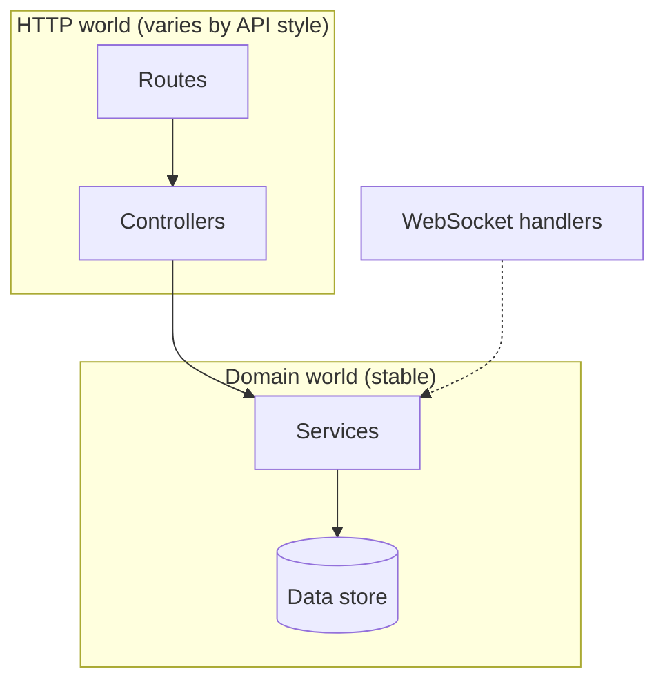

---
tags:
  - express
  - server
---

# 08 — Routing, Middleware, and Project Structure

> [!info] Prerequisites
> [[07 - Build Your First Server Without AI]]. Next: [[09 - Validation Auth and Security]].

## Middleware — the single most important Express concept

> [!abstract] Definition
> A middleware is a function `(req, res, next)` that runs **between** the incoming request and the final response. It may inspect, modify, short-circuit, or pass control on via `next()`.



Rules to know cold:
1. **Order IS the program.** `app.use(...)` runs top-to-bottom exactly as written (note 06 §2).
2. **Short-circuit** = send a response **without** `next()` — the chain stops. `apiKeyAuth` does this on 401.
3. **Error middleware** has **4 args** `(err, req, res, next)` — Express detects it by arity (note 06 §8).
4. **Mounting**: `app.use('/api', router)` prefixes every router path with `/api`.
5. `app.use(fn)` with no path runs for **everything**.

## Your real stack (`server/src/app.js`) — execution order

| # | Line | Middleware | Job | Break it and... |
|---|------|-----------|-----|-----------------|
| 1 | `app.js:14` | `helmet` | security headers | browser-side attacks open up |
| 2 | `app.js:34` | `cors` | origin whitelist + preflight | browser fetch blocked |
| 3 | `app.js:47` | `rateLimiter` | ≤100/min/IP → 429 | clients can hammer you |
| 4 | `app.js:50` | `express.json` | body → `req.body`, 10KB | every route parses by hand |
| 5 | route-level | `apiKeyAuth` | `x-api-key` gate on POST | anyone ingests fake data |
| 6 | `app.js:64` | `notFound` | 404 catch-all | Express default HTML error |
| 7 | `app.js:67` | `errorHandler` | all errors → JSON | leaks traces, inconsistent |

> [!question] Predict
> Move `app.use(express.json())` (line 50) to **after** `app.use('/api', sensorRoutes)` (line 54). What happens to `POST /api/sensors`?
>
> > [!success]- Answer
> > The route matches and runs **before** JSON parsing, so `req.body` is `undefined`. AJV validation fails → the ESP32 gets `400` on every request. This is the **#1 Express bug**, and it's a pure ordering issue. Order *is* the program.

> [!example] Write your own middleware (copy this pattern)
> ```js
> const timing = (req, res, next) => {
>   const start = Date.now();
>   res.on('finish', () => {
>     logger.info('request', { method: req.method, url: req.url, ms: Date.now() - start, status: res.statusCode });
>   });
>   next();
> };
> ```
> Mount with `app.use(timing)` at line 47. It never touches business logic — it *wraps* requests, exactly like `apiKeyAuth`. This is how all cross-cutting concerns are built.

## Routes — the mapping layer

`server/src/routes/sensor.routes.js` is declarations only:
```js
router.post('/sensors', apiKeyAuth, sensorController.postSensorData);
router.get('/sensors', sensorController.getLatestSensorData);
router.get('/health', sensorController.getHealthStatus);
```
- Route-level middleware runs only for that route → `apiKeyAuth` guards POST but not GET.
- `router.post(path, mw1, mw2, handler)` accepts any number of functions, run in order via `next()`.

> [!important] The route-reading skill
> `router.post('/sensors', A, B, C)` means: match → run A → B → C, each calling `next()`. **A route list fully describes an endpoint's flow.** GET has no auth; POST does. You can read security from the route file alone.

### Path params & ordering
`GET /api/sensors/:id` → `req.params.id`. Routes match **in order**: declare `GET /sensors/latest` **before** `GET /sensors/:id`, or "latest" is captured as an `:id`. 

> [!bug] Debug challenge
> You add:
> ```js
> router.get('/sensors/:id', ...)   // line A
> router.get('/sensors/health', ...) // line B
> ```
> `GET /api/sensors/health` now hits the `:id` handler with `id="health"`. **Fix it** and explain why order matters. (Also note `/api/health` already exists in `app.js` — a naming collision worth cleaning up.)

## Controllers — HTTP translation only

A controller's job: translate HTTP ↔ domain.
- ✅ Read `req.body/params/query`, call a service, shape `res`, forward errors with `next(err)`.
- ❌ Business rules here (they belong in services).
- ❌ DB access here.
- ❌ `res.send` then continue executing (double-response bug).

Your `sensor.controller.js` follows this, though it also does validation (§4 of note 06) — moving that to middleware is a clean refactor.

> [!example] Refactor exercise
> Extract validation into middleware:
> ```js
> // middleware/validateSensor.js
> const { validateSensorData } = require('../validators/sensor.schema');
> module.exports = (req, res, next) => {
>   if (!validateSensorData(req.body)) {
>     return res.status(400).json({ error: 'Invalid payload', details: validateSensorData.errors });
>   }
>   next();
> };
> ```
> Then `router.post('/sensors', apiKeyAuth, validateSensor, sensorController.postSensorData);`
> Run `npm test` — the 400 test must still pass. **Note the route now reads like a story: auth → validate → store.**

## Services — where the program lives

`sensorStore.service.js` holds state + decisions, no `req`/`res`. Why this matters:
1. **Reuse** — a WebSocket handler (note 10) or a test calls it directly.
2. **Testability** — assert `getLatestReading()` without HTTP.
3. **Swappability** — replace memory with Postgres by changing only this file.



That's the architectural takeaway of notes 06–08.

## The 12-factor config habit

`server/src/config/index.js` reads `process.env` **once** for the whole app. Rules:
- `.env` gitignored; `.env.example` committed (your repo has both).
- One config module; `process.env` read only there.
- **Fail fast**: production should `process.exit(1)` if `API_KEY` is missing (currently it silently becomes `undefined` → all POSTs 401).

> [!bug] Debug challenge
> `.env` is missing `API_KEY`. Server starts fine. Every ESP32 POST returns `401`. Where exactly does the failure originate, and what **one line** would make the server refuse to start instead?
>
> > [!success]- Answer
> > `config/index.js:4` → `apiKey: process.env.API_KEY` becomes `undefined`. `apiKeyAuth.js:13` compares `apiKey !== config.apiKey` → always true → 401. Add to config: `if (!process.env.API_KEY && process.env.NODE_ENV === 'production') { console.error('API_KEY required'); process.exit(1); }`. **Fail fast, not weird.**

## Growth structure
```
src/
├── app.js            ← middleware + mounts
├── server.js         ← listener + signals
├── config/           ← env → typed config
├── routes/           ← URL → controller
├── controllers/      ← HTTP translation
├── services/         ← business logic
├── repositories/     ← DB access (appears with a DB — note 13)
├── middleware/       ← auth, limits, errors
├── validators/       ← schemas
└── utils/            ← logger, helpers
```
`services` splits into `services` + `repositories` once a DB exists.

## Build it yourself (no AI)
- [ ] Write the `timing` middleware; mount above and below `cors`; does it log OPTIONS preflights? Why?
- [ ] Write `apiKeyAuth` from memory (15 lines); compare to `middleware/apiKeyAuth.js` after.
- [ ] Do the `validateSensor` refactor; keep tests green.
- [ ] Draw the exact execution order for `POST /api/sensors` — every function, including `express.json`.
- [ ] Answer: why does `errorHandler` need 4 params even though it never calls `next`?

## Resources
- Playlist: [Backend from first principles](https://youtube.com/playlist?list=PLui3EUkuMTPgZcV0QhQrOcwMPcBCcd_Q1)
- [Express: Using middleware](https://expressjs.com/en/guide/using-middleware.html) · [Writing middleware](https://expressjs.com/en/guide/writing-middleware.html)
- [The Twelve-Factor App — config](https://12factor.net/config)

Next: [[09 - Validation Auth and Security]]
