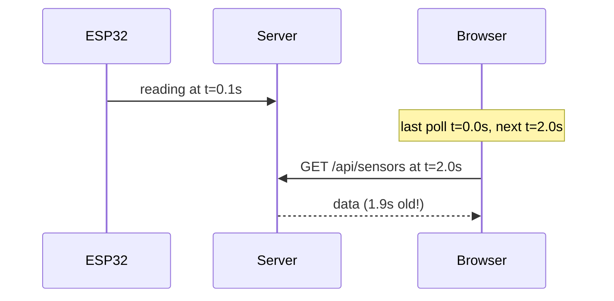

---
tags:
  - websocket
  - realtime
  - latency
---

# 10 — WebSockets for Real-Time Data

> [!info] Prerequisites
> [[03 - HTTP Fundamentals]], [[06 - Your Codebase Line by Line]], [[07 - Build Your First Server Without AI]]. Next: [[11 - GraphQL API]].
>
> This note fixes your project's biggest weakness: the frontend **polls every 2 seconds** and is therefore always up to 2 seconds behind reality.

## 1. The latency you have right now

`frontend/src/hooks/useSensorData.ts:9`:
```ts
export function useSensorData(pollInterval = 2000) {
  return useQuery({
    queryKey: QUERY_KEYS.sensorData,
    queryFn: api.getSensorData,
    refetchInterval: pollInterval,        // Dashboard passes POLL_INTERVAL = 2000
    refetchIntervalInBackground: true,
  });
}
```
`frontend/src/components/Dashboard.tsx:25` → `const POLL_INTERVAL = 2000;` → line 31 `useSensorData(POLL_INTERVAL)`.

The browser asks "any new data?" every 2 seconds — **whether or not anything changed**.



| Problem | In your system |
|---------|----------------|
| **Latency** | avg staleness ≈ interval/2 ≈ **1s**, worst ≈ **2s** — bad for `crash_detected` |
| **Wasted work** | 1 GET per tab per 2s = **43,200/day per tab**, even when the ESP32 is offline |
| **Can't push** | HTTP is client-initiated; the server can't say "crash — NOW" |
| **Scaling** | N browser tabs → N/2 requests/sec, all answered with identical data |

Polling interval is a latency dial; it can't reach zero. To break the trade-off, change the transport.

> [!example] Measure your own latency
> Open the dashboard, open DevTools → Network, filter `sensors`. Watch a `GET` fire every 2s like clockwork, even with the ESP32 off. **That's the waste you're about to delete.**

## 2. Alternatives compared

| Mechanism | Direction | Latency | Overhead | Complexity | Fit |
|-----------|-----------|---------|----------|------------|-----|
| **Polling** (current) | client→server | 0–2s | high | trivial | ✗ |
| Long polling | client asks, server holds | near-real-time | medium | medium | legacy |
| **SSE** | server→client one-way | low | low | easy | push-only |
| **WebSocket** | **both, persistent** | **minimal** | ~0 after handshake | medium | ✅ |
| MQTT | broker pub/sub | low | tiny | needs broker | ESP32 fleets |

> [!important] SSE vs WebSocket
> SSE = HTTP stream the server pushes (text, one-way). WebSocket = **full-duplex persistent connection** (both sides send anytime, binary too). Push-only dashboards can use SSE; if you want browser→device commands later, use WebSocket.

## 3. How the protocol works

### The handshake (it *starts* as HTTP)
```
GET /ws HTTP/1.1
Upgrade: websocket
Connection: Upgrade
Sec-WebSocket-Key: x3JJHMbDL1EzLkh9GBhXDw==
Sec-WebSocket-Version: 13
```
```
HTTP/1.1 101 Switching Protocols
Upgrade: websocket
Connection: Upgrade
Sec-WebSocket-Accept: HSmrc0sMlYUkAGmm5OPpG2HaGWk=
```
- **`101 Switching Protocols`** — the only 1xx you'll see. After it, the TCP connection carries **WebSocket frames**, not HTTP.
- `Sec-WebSocket-Accept` (derived from the Key + a fixed GUID) proves you reached a real WS server.

### Frames, not requests
Frames carry opcode (text/binary/close/ping/pong) + payload; client→server frames are masked. No per-message headers, no per-message URL — tiny frames on one open socket. Consequences:
- Connection **stays open** → you need **heartbeats** (ping/pong) and a **close handler** (Wi-Fi drops are silent).
- **One URL per connection** (`/ws`) → "which data?" lives in the **message payload** (`{type, data}`), not the path.
- Browsers cap ~6 connections/origin.

## 4. Server side — the `ws` package

```
cd server && npm install ws
```
Create `server/src/ws.js`:
```js
const { WebSocketServer } = require('ws');
const sensorStore = require('./services/sensorStore.service');
const logger = require('./utils/logger');

const clients = new Set();

const createWs = (server) => {
  const wss = new WebSocketServer({ server, path: '/ws' });

  wss.on('connection', (ws, req) => {
    clients.add(ws);
    logger.info('WS client connected', { ip: req.socket.remoteAddress, total: clients.size });

    ws.send(JSON.stringify({ type: 'snapshot', data: sensorStore.getLatestReading() }));

    ws.on('message', (raw) => handleMessage(ws, raw));
    ws.on('close', () => { clients.delete(ws); logger.info('WS client left', { total: clients.size }); });
    ws.on('error', (err) => logger.error('WS error', { error: err.message }));

    ws.isAlive = true;
    ws.on('pong', () => { ws.isAlive = true; });
  });

  const heartbeat = setInterval(() => {
    wss.clients.forEach((ws) => {
      if (!ws.isAlive) return ws.terminate();
      ws.isAlive = false;
      ws.ping();
    });
  }, 30000);

  wss.on('close', () => clearInterval(heartbeat));
  return wss;
};

const handleMessage = (ws, raw) => {
  try {
    const msg = JSON.parse(raw);
    if (msg.type === 'ping') ws.send(JSON.stringify({ type: 'pong', t: Date.now() }));
  } catch {
    ws.send(JSON.stringify({ type: 'error', message: 'invalid JSON' }));
  }
};

const broadcast = (type, data) => {
  const payload = JSON.stringify({ type, data });
  clients.forEach((ws) => { if (ws.readyState === ws.OPEN) ws.send(payload); });
};

module.exports = { createWs, broadcast };
```
Design decisions to understand:
- `new WebSocketServer({ server, path: '/ws' })` — **reuses the port-3000 HTTP server**. No new port, no CORS headaches, shared TLS.
- `clients: Set` = registry of open sockets; `broadcast` loops it. **One ESP32 update → one broadcast → all browsers instantly.**
- `readyState === OPEN` guard prevents "send on closing socket" throws.
- **Heartbeat** kills half-open ghost connections (phone slept, cable pulled). Without it, `clients` leaks forever.
- **Snapshot on connect** gives late joiners instant state.
- `handleMessage` wraps `JSON.parse` in try/catch — treat browser input as hostile (note 09).

### The trigger — one line in the controller
In `sensor.controller.js`, after the store update (`:48`):
```js
sensorStore.updateReading(req.body);
broadcast('reading', sensorStore.getLatestReading());
```
And mount in `server/src/server.js`:
```js
const { createWs } = require('./ws');
const server = app.listen(...);
createWs(server);
```

> [!important] Why this is clean (note 08 payoff)
> The **service** is HTTP-free, so HTTP (ESP32 POST) and WebSocket (browser push) both sit in front of it, sharing one brain. You didn't touch the service to add realtime.

## 5. React client — replace the polling hook

`frontend/src/hooks/useSensorWebSocket.ts`:
```tsx
import { useEffect, useState } from 'react';
import type { SensorDataResponse } from '../types/sensor';

export function useSensorWebSocket() {
  const [data, setData] = useState<SensorDataResponse | null>(null);
  const [status, setStatus] = useState<'connecting' | 'open' | 'closed'>('connecting');

  useEffect(() => {
    let ws: WebSocket | undefined;
    let retry = 0;
    let mounted = true;

    const connect = () => {
      const proto = location.protocol === 'https:' ? 'wss' : 'ws';
      ws = new WebSocket(`${proto}://${location.host}/ws`);

      ws.onopen = () => { retry = 0; setStatus('open'); };
      ws.onmessage = (e) => {
        const msg = JSON.parse(e.data);
        if (msg.type === 'snapshot' || msg.type === 'reading') setData(msg.data);
      };
      ws.onclose = () => {
        if (!mounted) return;
        setStatus('closed');
        retry += 1;
        setTimeout(connect, Math.min(1000 * 2 ** retry, 15000));
      };
      ws.onerror = () => ws.close();
    };

    connect();
    return () => { mounted = false; ws?.close(); };
  }, []);

  return { data, status };
}
```
Then in `Dashboard.tsx`, swap the data source but keep the rest:
```tsx
const { data: sensorData, status: wsStatus } = useSensorWebSocket();
```
The chart-appending effect (lines 34–41) and all the `status/source/ageMs` reads keep working — because the WS payload is the **same object** `getLatestReading()` produced. That's the value of a consistent contract (note 02).

> [!warning] Five things every production WS client needs
> 1. `ws:`/`wss:` based on page protocol (HTTPS requires `wss:`).
> 2. **Auto-reconnect with backoff** (cap ~15s) — deploys restart connections constantly.
> 3. `mounted` guard + `ws.close()` on unmount (React StrictMode double-mounts in dev — watch server logs to see leaked sockets if you forget).
> 4. Validate message shape before trusting it.
> 5. Keep a polling fallback path (WS tries, falls back after N failures).

> [!bug] Debug challenge
> Your hook reconnects instantly on `onclose` with no delay. Deploy the server (every client disconnects at once). What happens to the server on restart? (Answer: a **thundering herd** — thousands of tabs reconnect simultaneously. Fix: exponential backoff + jitter. The code above caps at 15s.)

## 6. Socket.IO — batteries included
`ws` = the protocol. **Socket.IO** = a library adding auto-reconnect, delivery guarantees, rooms/namespaces, ACKs, and fallback to long-polling when WS is blocked (corporate proxies).
```js
const { Server } = require('socket.io');
const io = new Server(httpServer, { cors: { origin: allowedOrigins } });
io.on('connection', (socket) => {
  socket.emit('reading', sensorStore.getLatestReading());
});
io.emit('reading', data);   // broadcast
```
Choose `ws` to learn the protocol (recommended first), Socket.IO for product reliability. Knowing *why* is the signal.

## 7. ESP32 side
Today the ESP32 uses `HTTPClient` POST every 500ms (`config.h:31 PACKET_INTERVAL_MS`). It can instead be a WS **client** (Arduino `WebSocketsClient`: `ws.begin(host, port, "/ws")`) — one persistent connection, tiny frames, and **server→device commands**. At fleet scale, **MQTT** (publish/subscribe via a broker) fits constrained devices with QoS. Your `docs/README.md` "Future Improvements" lists WebSocket/MQTT for exactly this.

## 8. Latency comparison (your system)

| Approach | Browser staleness | Requests/hour (3 tabs) |
|----------|-------------------|------------------------|
| Polling @2s (current) | 0–2s | 16,200 |
| Polling @200ms | 0–0.2s | 162,000 |
| **WebSocket push** | **≈0–50ms** | **~0** |

## Build it yourself (no AI)
- [ ] **M1**: `npm i ws`; mount `createWs(server)` in `server.js`; connect from DevTools console: `const ws = new WebSocket('ws://localhost:3000/ws'); ws.onmessage = e => console.log(e.data)`. See the snapshot.
- [ ] **M2**: add `broadcast('reading', ...)` in the controller. POST via curl; watch the browser receive it with **zero** polling. Log `Date.now()` to measure the delay.
- [ ] **M3**: build `useSensorWebSocket`, swap it into `Dashboard`; every curl POST updates the UI in real time.
- [ ] **M4**: kill the server, restart it; confirm the tab reconnects via backoff.
- [ ] **M5**: open **two** tabs; one curl POST updates **both** simultaneously (that's `broadcast`).
- [ ] Answer: what does `101` mean? Why heartbeats? Why must WS clients reconnect but HTTP requests don't?

## Resources
- Playlist: [Backend from first principles](https://youtube.com/playlist?list=PLui3EUkuMTPgZcV0QhQrOcwMPcBCcd_Q1)
- [RFC 6455 — WebSocket Protocol](https://www.rfc-editor.org/rfc/rfc6455.html) (§4.1–4.2 handshake)
- [MDN: WebSocket API](https://developer.mozilla.org/en-US/docs/Web/API/WebSockets_API)
- [`ws`](https://github.com/websockets/ws) · [Socket.IO](https://socket.io/docs/v4/)

Next: [[11 - GraphQL API]]
