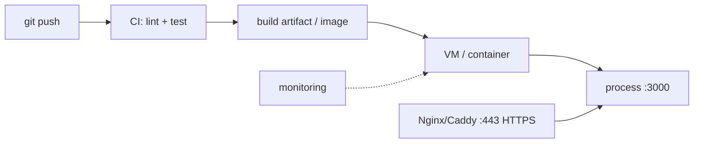

---
tags:
  - testing
  - production
  - devops
---

# 12 — Testing, Logging, and Going to Production

> [!info] Prerequisites
> [[08 - Routing Middleware and Project Structure]], [[06 - Your Codebase Line by Line]]. Next: [[13 - Backend Developer Roadmap]].
> Working on your laptop is step one. Pro backend = it works **forever, for others, while you sleep**.

## 1. Testing — the three levels

| Level | What | Tool in your repo | Speed |
|-------|------|-------------------|-------|
| **Unit** | one function/service | Jest | ms |
| **Integration** | real Express app over HTTP | **Supertest** + Jest | seconds |
| **E2E** | full stack + browser | Playwright/Cypress | minutes |

Your `server/tests/sensor.test.js` uses the gold-standard pattern:
```js
process.env.API_KEY = 'test-api-key';
process.env.NODE_ENV = 'test';
const request = require('supertest');
const app = require('../src/app');

test('POST /api/sensors without API key should return 401', async () => {
  const res = await request(app).post('/api/sensors').send({ device_id: 'test', uptime_ms: 123 });
  expect(res.statusCode).toBe(401);
});
```
- `process.env` is set **before** requiring the app → `config` picks up the test key (same ordering rule as `dotenv` in `server.js`).
- `request(app)` runs the **real app in-process** — no live port. This works *because* `app.js` exports the app and `server.js` does the `listen` (note 06 §1). **That split exists for testability.**

> [!important] Derive tests from the contract
> The 7 tests in `sensor.test.js` read like the API spec: health → sensors fallback → 401 (missing key) → 401 (wrong key) → 400 (bad body) → 200 (valid) → GET returns `ok`. If you can write these from `docs/README.md` alone, you understand your contract.

> [!warning] A real flaw in the test file
> The last test ("after valid post should return ok") **depends on the 6th test having POSTed first** — they share the module-level `sensorStore` singleton. Run the last test alone (`npx jest -t "after valid post"`) and it fails. This is the "shared mutable state between tests" smell.

> [!bug] Debug challenge — fix the test isolation
> Add a `beforeEach` that resets the store so every test starts clean:
> ```js
> const sensorStore = require('../src/services/sensorStore.service');
> beforeEach(() => {
>   sensorStore.lastValidReading = null;
>   sensorStore.lastContactTime = null;
>   sensorStore.lastDeviceTimestamp = null;
> });
> ```
> Then make the "ok status" test **POST its own data first**. Run `npm test`. Every test now stands alone.

### The testing pyramid for APIs
Many fast **unit** tests on the service (pure logic: ok/stale/fallback — no HTTP), a ring of **integration** tests on routes/middleware, a thin layer of E2E. Your service being HTTP-free (note 08) makes the unit tier trivial.

### What to test (from the outside in)
1. Happy path → 200 + body shape.
2. Every documented error → 401/400/413/429/404.
3. State transitions → POST → `ok`; wait > `staleAfterMs` → `stale`; fresh boot → `fallback`.
4. Edge cases → duplicate payload, out-of-order `uptime_ms` (reboot case, `sensorStore.service.js:56`).

> [!example] Write 3 tests from the contract (no AI)
> - `GET /api/health` on a fresh store → `status: 'unhealthy'`
> - POST with `NaN` in a number field → 400
> - POST then GET → `status: 'ok'`, `source: 'esp32'`
> Run `npm test`; make them pass by reading failures, not guessing.

## 2. Logging — your production memory

`console.log` is for toys; production needs **levels, structure, context**. Your `utils/logger.js` is a thin console wrapper (`info/warn/error/debug`) — **not** winston, even though `package.json` lists winston as a dependency (unused). Two real issues to fix (note 06 §9):
1. `LOG_LEVEL` from `.env` is ignored — `debug` always prints.
2. winston is installed but never imported — dead weight.

Structured logs carry machine-readable fields:
```js
logger.warn('Invalid sensor data received', { errors, ip: req.ip });
```
Log **state transitions and failures**, not every success — 40 req/s of `info` noise hides the one `error`. Always log: boot config (`server.js:10`), auth failures (`apiKeyAuth` — currently missing), validation failures (`controller:15`), unhandled errors with stack (`errorHandler:4`), device connectivity changes (`sensorStore:60` reboot detection).

> [!warning] Never log secrets
> Not full API keys, passwords, tokens, or user GPS coordinates. `apiKeyAuth` logs rejections — make sure the key itself never enters a field. Check `logger.error` calls for accidentally-included headers.

> [!bug] Debug challenge
> Make `utils/logger.js` respect `config.logLevel`: only print `debug` when `LOG_LEVEL=debug`. Test: `LOG_LEVEL=info npm start` (debug lines vanish) vs `LOG_LEVEL=debug npm start`.

## 3. Graceful shutdown — why `server.js` looks like that
```js
server.close(() => { process.exit(0); });
process.on('SIGTERM', () => gracefulShutdown('SIGTERM'));
process.on('SIGINT',  () => gracefulShutdown('SIGINT'));
```
- `SIGINT` = Ctrl+C; `SIGTERM` = `docker stop`/pm2.
- `server.close(cb)` = stop new connections, **finish in-flight**, then cb. Hard-killing drops active requests and cuts WS connections mid-frame.
- A pro adds: a **force-exit timer** (drain can hang — exit after 10s), closing the DB pool, `wss.close()` for WebSockets (note 10), and flushing logs.

> [!example] Add the force-exit timer
> ```js
> const gracefulShutdown = (signal) => {
>   logger.info(`${signal} received, shutting down gracefully`);
>   const force = setTimeout(() => { logger.error('Forced exit'); process.exit(1); }, 10000);
>   if (server) server.close(() => { clearTimeout(force); logger.info('Server closed'); process.exit(0); });
>   else process.exit(0);
> };
> ```
> Simulate a stuck connection and watch it force-exit after 10s.

## 4. Environment discipline

| | Development | Production |
|---|---|---|
| `NODE_ENV` | `development` | `production` |
| Error detail | stack traces (`errorHandler.js:29`) | generic only |
| Reload | `node --watch` (`npm run dev`) | pm2/systemd or container restart |
| Secrets | local `.env` | secret manager / orchestrator |
| Logs | colored stdout | JSON stdout → collected |

`config/index.js` reads env **once**, coerced, with defaults. Production should `exit(1)` on a missing `API_KEY` rather than 401-ing forever (note 08 debug challenge).

## 5. Deploying a Node server (mental model)

Levels to grow through:
1. **VM** + **pm2**/systemd (`Restart=always`) + Nginx for TLS & static frontend. Minimum respectable.
2. **Docker** (`FROM node:20-alpine`, `npm ci --omit=dev`, `CMD ["node","src/server.js"]`) + `.dockerignore` (never bake `node_modules`/`.env`).
3. **PaaS** (Render/Railway/Fly) — push repo, set env, done.
4. **Kubernetes** — only when you actually need it.

Non-negotiables: HTTPS, health endpoint exposed (`/api/health` — your LB/monitor polls it), env-var secrets, restart-on-crash, log collection.

## 6. Observability — three pillars
1. **Logs** — what happened (winston, done right).
2. **Metrics** — request rate, latency, errors, memory (Prometheus/Grafana). Watch `process.memoryUsage()`.
3. **Traces** — one request across services (OpenTelemetry) — matters at microservice scale.
Plus **alerting**: page when 5xx spikes or `/health` stays `unhealthy` >5 min.

## 7. Performance fundamentals
- **Node is single-threaded** — sync CPU work blocks all requests → workers/queues.
- **DB will be your bottleneck** (note 13), not Express.
- **Caching**: in-process (your `sensorStore` is one) → Redis → CDN. Invalidation is the hard part — `staleAfterMs` is a taste of it.
- **Horizontal scaling caveat**: in-memory store → two instances = two truths. Stateless servers + a real DB is the standard fix.

## Build it yourself (no AI)
- [ ] Read `sensor.test.js` fully; add the 3 contract tests above; make them pass; then fix the shared-state flaw with `beforeEach`.
- [ ] Add a `timing` middleware; run `LOG_LEVEL=debug`; filter requests >50ms.
- [ ] Add the force-exit timer; simulate a hung connection.
- [ ] Write a Dockerfile from the sketch; build, run, curl the API through the container. Does `docker inspect` show your `.env`? (It shouldn't.)
- [ ] Answer: why doesn't `app.js` call `listen`? Why log stale warnings but not every ok? What does `SIGTERM` tell the process?

## Resources
- Playlist: [Backend from first principles](https://youtube.com/playlist?list=PLui3EUkuMTPgZcV0QhQrOcwMPcBCcd_Q1)
- [Jest](https://jestjs.io/docs/getting-started) · [Supertest](https://github.com/ladjs/supertest) · [winston](https://github.com/winstonjs/winston)
- [The Twelve-Factor App](https://12factor.net/) — read all 13 pages; it *is* the production curriculum
- [Docker: Node.js guide](https://docs.docker.com/guides/nodejs/)

Next: [[13 - Backend Developer Roadmap]]
